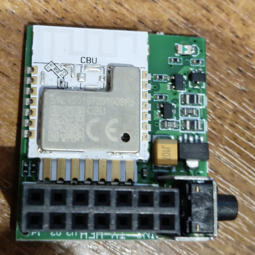
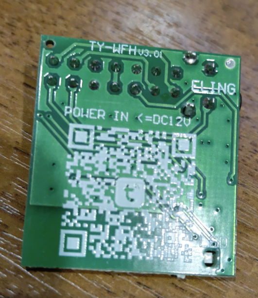
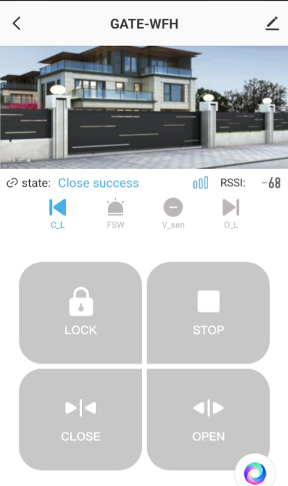

# Ворота WFH в Home Assistant (hoas-gate-wfh-localtuya)

Локальное управление воротами с контроллером **WFH** (Tuya, Wi-Fi) в Home Assistant — без облака.
Версия конфигурации: **v1.4** (24.11.2026)

**Стек:** Home Assistant OS + HACS + форк [xZetsubou/hass-localtuya](https://github.com/xZetsubou/hass-localtuya), протокол **Tuya 3.5**.

> ⚠️ **Ключевые факты:**
> - Контроллер WFH работает **только по протоколу Tuya 3.5** (проверено tinytuya).
> - Оригинальная LocalTuya (rospogrigio) 3.5 **не поддерживает** — нужен форк **xZetsubou**.
> - Команды — платформа `button` (momentary); концевики — строго `binary_sensor`.
> - Перед публикацией/использованием подставьте свои `IP`, `Device ID` и `Local Key` вместо плейсхолдеров. **Не коммитьте реальный local key!**

---

## Оборудование

**Привод:** откатные ворота **NI1000Z Turbo v6.21**

**Беспроводной модуль:** **TY-WFHv3.01** (производитель ELING или OEM-партнёр, маркировка на плате).
Построен на базе чипа **Tuya CBU** — стандартного Wi-Fi модуля, который используется в миллионах устройств умного дома. Модуль интегрируется в плату управления привода ворот (откатных или распашных) и даёт управление со смартфона из любой точки мира, сценарии и расписания. Управление из Home Assistant идёт по локальной сети, облако Tuya не требуется. Питание модуля: `POWER IN <= DC12V`.

| Плата сверху (модуль CBU) | Плата снизу (маркировка) | Приложение Tuya |
|---|---|---|
|  |  |  |

> ⚠️ **Важно про кнопку LOCK:** в фирменном приложении Tuya и в кодах DP (`wfh_lock`, DP 104) кнопка называется **LOCK** — но это **НЕ блокировка**! Это **режим «Калитка»**: ворота открываются примерно на 1 метр для прохода пешком. В нашей конфигурации эта команда называется `Gate Wicket` (калитка).

---

## Карта устройств

Единая таблица: назначение каждого DP + как его добавлять в LocalTuya (шаг 4).

| DP | code | Доступ | Назначение | Платформа | Friendly Name | Доп. поля |
|---|---|---|---|---|---|---|
| 101 | wfh_open | rw | Открыть (импульс) | `button` | Gate Open | — |
| 102 | wfh_close | rw | Закрыть (импульс) | `button` | Gate Close | — |
| 103 | wfh_stop | rw | Стоп (импульс) | `button` | Gate Stop | — |
| 104 | wfh_lock | rw | **Калитка** — частичное открытие ~1 м (не блокировка!) | `button` | Gate Wicket | — |
| 105 | return_state | ro | Код состояния: 2=открывается, 3=открыто, 4=закрывается, 5=закрыто, **6=калитка, 11=остановлен** | `sensor` | Gate Return State | — |
| 106 | l_close | ro | Концевик «закрыто» | `binary_sensor` | Gate Closed Limit | только binary_sensor, НЕ switch! |
| 107 | l_open | ro | Концевик «открыто» | `binary_sensor` | Gate Open Limit | только binary_sensor, НЕ switch! |
| 108 | inrf | ro | Диагностический вход (назначение уточняется) | `binary_sensor` | Gate INRF | entity category: Diagnostic |
| 109 | fsw | ro | Фотоэлементы (индикатор FSW в приложении) | `binary_sensor` | Gate FSW | entity category: Diagnostic; device class: `safety` |
| 110 | fast_op | rw | **Турбо-открытие** (команда, не настройка!) | `button` | Gate Fast Open | как DP 101-104 |
| 111 | hidden_state | ro | Служебный — в сущности не выводится | — | — | — |
| 112 | wfh_rssi | ro | Уровень Wi-Fi, dBm | `sensor` | Gate WiFi RSSI | device class: Signal strength, ед. `dBm` |

Производные сущности:
- `cover.gate_wfh` — ворота целиком: open / opening / closing / closed + команды (блок `cover:` в `configuration.yaml`)
- `sensor.gate_wfh_gate_return_state_text` — расшифровка кода привода текстом (UI-помощник)
- `sensor.gate_wfh_gate_status_text` — «Открыты полностью / Закрыты полностью / Открыты частично» (UI-помощник; «частично» = калитка или остановка посреди хода)

> Имена сущностей в файлах — с префиксом `gate_wfh_` (так назвала интеграция по имени устройства/зоны). У вас префикс будет свой — замените во всех файлах или переименуйте сущности в HA.

---

## Установка

### Шаг 1. HACS и форк LocalTuya

1. Если стоит оригинальная LocalTuya (rospogrigio) — удалить (настройки устройств сохранятся).
2. **HACS → ⋮ → Пользовательские репозитории:** `https://github.com/xZetsubou/hass-localtuya`, тип **Integration**.
3. Установить → **перезапустить HA**.

### Шаг 2. Резервирование IP

В роутере привяжите IP контроллера к его MAC (Static DHCP / Address Reservation).

### Шаг 3. Добавление устройства

**Настройки → Устройства и службы → + Добавить интеграцию → LocalTuya → Add a new device:**

| Поле | Значение |
|---|---|
| Name | `GATE-WFH` |
| Host | `192.168.x.x` (локальный IP контроллера) |
| Device ID | `YOUR_DEVICE_ID` |
| Local Key | `YOUR_LOCAL_KEY` |
| **Protocol version** | **`3.5`** |
| Manual DPS to add | `101,102,103,104,105,106,107,108,109,110,111,112` |
| DPIDs for RESET command | пусто |

> «no datapoints found» → выгрузите Smart Life из памяти на всех телефонах (устройство держит одно локальное подключение) и/или обесточьте контроллер на 15 секунд.

### Шаг 4. Сущности

Мастер предложит добавить сущность. Добавляйте по одной (галочка «Add another entity», после последней — снять).

Каждую строку берите из таблицы **«Карта устройств»** выше, в порядке DP 101 → 112 (DP 111 пропускаем):

1. **Платформа** — из колонки «Платформа» (button / binary_sensor / sensor).
2. **DP ID** — номер из первой колонки (в выпадающем списке виден code для проверки).
3. **Friendly Name** — точно как в колонке «Friendly Name» — тогда entity_id совпадут с именами в файлах проекта.
4. **Доп. поля** — по колонке «Доп. поля»; если «—» — оставить по умолчанию.

> ⚠️ Концевики 106/107 — read-only, **только binary_sensor**, не switch!
> Командные DP 101–104 и 110 — **только button**, не switch (кнопка = импульс без состояния; 110 — это команда «турбо», а не настройка!).
> Поле **On Values** у всех binary_sensor не трогаем: значение по умолчанию `true,1,pir,on` уже ловит булево `True`. Его меняют только если DP возвращает не bool (строку/число) — у нас таких нет.

### Шаг 5. Текстовые сенсоры (UI-помощники)

**Настройки → Устройства и службы → Вспомогательные элементы → + Создать вспомогательный объект → прокрутить вниз → Template → в списке типов выбрать «Сенсор»** (НЕ «Бинарный сенсор»!).

**Gate Return State Text** — шаблон состояния:
```jinja



{{ map.get(code, 'Неизвестно (' ~ s ~ ')') }}
```

**Gate Status Text** — шаблон состояния:
```jinja
Открыты полностью
Закрыты полностью
Открыты частично
```

Остальные поля пустыми. «Неизвестно (N)» — ловушка для нерасшифрованных кодов привода.

### Шаг 6. Пакет ворот (правим configuration.yaml один раз)

Механизм **packages**: одна правка `configuration.yaml` — и дальше вся логика ворот живёт в отдельном файле.

1. Одноразово в `configuration.yaml` добавьте (или дополните существующий блок `homeassistant:`):
   ```yaml
   homeassistant:
     packages: !include_dir_named packages
   ```
2. Создайте папку **`packages`** рядом с `configuration.yaml` и положите туда `gate_wfh_package.yaml` из этого репозитория (cover + автоматизация «ворота забыли закрыть»).
3. Настройки → Система → ⋮ → **Проверить конфигурацию** → **Перезапустить**.

Результат: `cover.gate_wfh` со статусами open / opening / closing / closed (по DP 105, резерв — концевики).

> Дальше `configuration.yaml` не трогаем: все изменения — только в `packages/gate_wfh.yaml`. Отключить всё разом = переименовать в `.bak` + перезапуск.

### Шаг 7. Карточка дашборда

Дашборд → ⋮ → Изменить → + Добавить карточку → **Вручную (Manual)** → вставить всё из `gate_wfh_lovelace.yaml`.

> `gate_wfh_localtuya.yaml` → в `configuration.yaml`; `gate_wfh_lovelace.yaml` → в карточку. Ошибка «No card type configured» = перепутаны файлы.

### Шаг 8. Проверка

1. **Открыть** → `opening` → `open`, концевик открытия = on.
2. **Стоп** посреди хода → «Состояние привода» = Остановлен (код 11).
3. **Калитка** → открытие ~1 м → «Состояние привода» = Калитка (код 6), «Статус ворот» = Открыты частично.
4. **Закрыть** → `closing` → `closed`.

### Шаг 9 (опционально). Автоматизация «ворота забыли закрыть»

```yaml
alias: Gate left open
triggers:
  - trigger: state
    entity_id: binary_sensor.gate_wfh_gate_closed_limit
    to: "off"
    for: "00:10:00"
actions:
  - action: notify.notify
    data:
      title: "Ворота"
      message: "Ворота не закрыты уже 10 минут!"
mode: single
```

---

## Диагностика

| Симптом | Решение |
|---|---|
| `no datapoints found` | Закрыть Smart Life везде; перезагрузить контроллер по питанию; проверить форк xZetsubou и версию 3.5 |
| Сущности «Недоступно» | Перезагрузка контроллера; устройство занято Smart Life; проверить IP/пинг |
| «Объект не найден» в карточке | Сличить фактические ID (Настройки → Объекты) с кодом карточки |
| Концевики — переключатели | Пересоздать 106/107 как binary_sensor |
| Команды не работают | Проверить, что 101–104 созданы как button; журнал: Настройки → Система → Журналы → `localtuya` |
| `Error 28841002: IoT Core subscription expired` | На локальную работу не влияет |
| Перепривязка в Smart Life сломала всё | Сменился local key → обновить в Edit device |
| Тест протокола | `pip install tinytuya && python3 test_gate.py <IP>` |

## Файлы

| Файл | Назначение |
|---|---|
| `gate_wfh_localtuya.yaml` | Справочник DP + блок `cover:` для configuration.yaml |
| `gate_wfh_lovelace.yaml` | Карточка дашборда |
| `test_gate.py` | Тест связи с контроллером (перебор версий протокола) |

## История версий

- **v1.4** (24.11.2026) — DP 110 (`fast_op`) оказался командой «турбо-открытие» (проверено вживую): сущность пересоздана как `button` вместо `switch`; в карточке — пятая кнопка «Турбо», переключатель убран. Пакет не затронут.

- **v1.3** (24.11.2026) — единая схема имён без префикса `dvor_`: все 13 сущностей `gate_wfh_*` (кнопки, концевики, диагностика, свитч, помощники). Пакет и карточка обновлены под новые ID.

- **v1.2** (24.11.2026) — **исправление:** ключи действий template cover приведены к официальному синтаксису `open_cover` / `close_cover` / `stop_cover` (по [документации Template Cover](https://www.home-assistant.io/integrations/template/#cover)). С прежними `open` / `close` / `stop` конфиг не загружался.
- **v1.1** (22.11.2026) — коды return_state 6=калитка, 11=остановлен; в cover они дают статус `open`. Диагностика: DP 108 (`inrf`) и DP 109 (`fsw`, фотоэлементы). Раздел «Оборудование» с фото платы и предупреждением LOCK = калитка. Переход на packages: `gate_wfh_package.yaml` (cover + автоматизация) кладётся в `/config/packages/`, `configuration.yaml` правится один раз.
- **v1.0** (22.11.2026) — первая рабочая версия: форк xZetsubou, протокол 3.5, button + binary_sensor, UI-помощники, cover, карточка.
